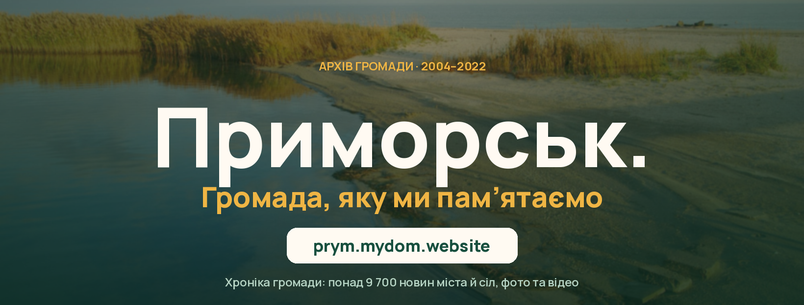
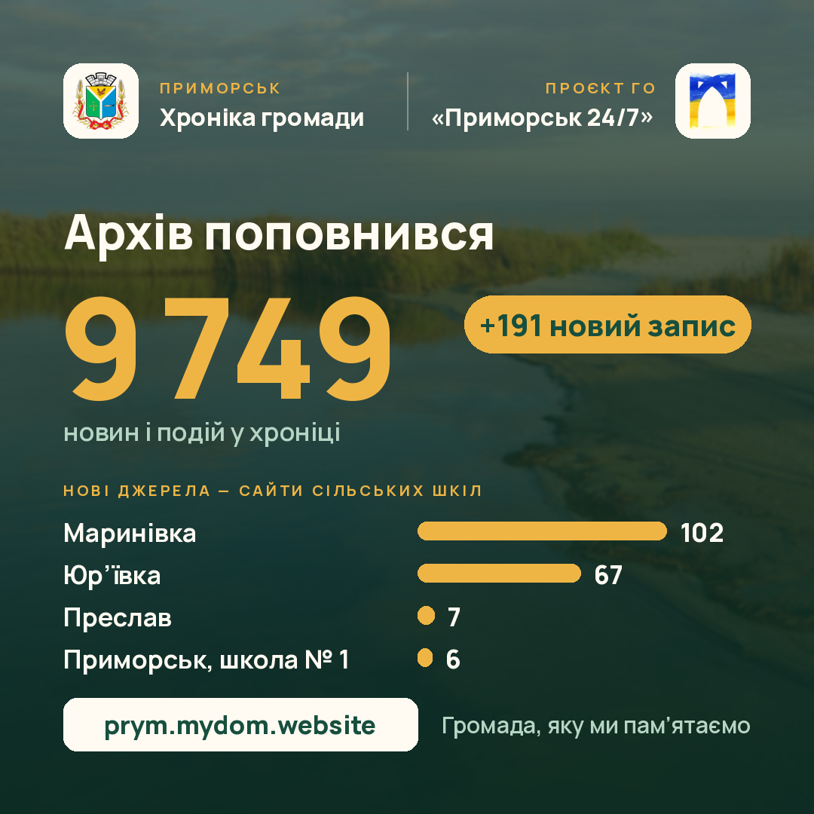

# Prymorsk. A Community Chronicle · Приморськ. Хроніка громади

**Live: [prym.mydom.website](https://prym.mydom.website)**



[English](#english) · [Українська](#українська)

---

## English

Prymorsk is a small town on the Sea of Azov in Zaporizhzhia Oblast, Ukraine, with the villages around it. It has been under occupation since 2022.
The town council's site, the local news portals, the schools' and villages' pages went offline one by one, and twenty years of the
community's life went with them: festivals, school assemblies, new roads, first gas in a village, people.

This project brings that life back from web archives and turns it into one chronicle a person can read, search and share.

### In numbers

- **9,700+** news items and events, **2004–2022**, from **30+** lost sites (town council, local media, NGO, schools, district administration, regional press)
- **29** settlements, each with its own page
- **1,800+** video stories (local copies preserved in the Internet Archive), **1,900+** articles with photos
- a printed local-history almanac (2021) turned into readable articles

### How it works

```
Wayback Machine (CDX) ─┐
Common Crawl index ────┼─▶ mirror (polite, resumable) ─▶ clean ─▶ protect ─▶ build ─▶ static site ─▶ Cloudflare
sites still online ────┘                                   │         │          │
                                                           │         │          └ article pages, village pages, sitemap,
                                                           │         │            «this day in history», book of the year
                                                           │         └ private people's names shortened («Ірина Д.»),
                                                           │           phones and e-mails masked, council records kept offline
                                                           └ junk/widgets removed, dead links resolved, encodings fixed,
                                                             Russian titles translated, headlines proofread
```

- **Collect.** `wayback_mirror.py` walks the Wayback CDX index for each lost site (one request per ~4 s, resumable, original HTML via `id_`);
  `live_mirror.py` saves sites that still answer (uCoz, Blogspot feeds); `cc_fetch.py` fills gaps from Common Crawl;
  `regional_collect.py` / `regional_fulltext.py` bring in regional media up to the last local record.
- **Clean.** `clean_article.py` extracts the article body per site, drops widgets and junk, balances markup, fixes Latin look-alikes,
  apostrophes and Roman numerals in Ukrainian text, and resolves links to files that no longer exist.
- **Protect.** `names.py` shortens private people's names in any case form (Ukrainian and Russian) while keeping public and historical
  figures whole; `mask_private` hides phones and e-mails. Raw mirrors are never published.
- **Build.** `extract_articles.py` → `timeline/data.json` (stable ids `md5(path)[:10]`); `pages.py` → one static page per article with
  Open Graph previews, village pages, a sitemap; `publish.py` copies only what pages reference.
- **Serve.** Static files on Cloudflare Workers; `worker.js` adds two endpoints backed by D1: readers' corrections (select a fragment →
  suggest a fix; rate-limited by a daily hash, no IP stored) and an article view counter (article id + day, nothing about the reader).
  No cookies, no third-party trackers.
- **Share.** `social/` renders square videos for Facebook from the chronicle itself («This day in history» for any date, archive updates)
  with a small sound kit synthesized from scratch (`sound.py`, stdlib only), and the page cover.

Python 3 standard library for the pipeline; Pillow and ffmpeg only for images and video. No frameworks, no build step for the front end.

### Run it

The archive's texts and photos are **not** in this repository (see Licence). With your own mirrors in place:

```bash
./build.sh                                            # self-checks, then data.json, article and village pages
python3 -m http.server 8000                           # open http://localhost:8000/timeline/
SITE_URL=https://example.org python3 publish.py       # assemble the folder Cloudflare serves ($PRYM_PUBLISH)
npx wrangler deploy                                   # needs your own D1 id in wrangler.jsonc
.venv/bin/python social/day_video.py 10-16            # a 30 s «this day» video + its post text
```

Self-checks: `python3 names.py`, `python3 clean_article.py`, `python3 pages.py`, `python3 translations.py`.

### Licence

Code: [MIT](LICENSE). The texts, photos and videos of the chronicle belong to their authors and the original publications; they are
not covered by the MIT licence and are not part of this repository. Manrope font: SIL Open Font License (`social/Manrope-OFL.txt`).

A project of the NGO «Приморськ 24/7».

---

## Українська

Приморськ — невелике місто на Азовському морі в Запорізькій області разом із селами громади. З 2022 року громада живе в окупації.
Сайт міської ради, місцеві новинні портали, сторінки шкіл і сіл зникали один за одним, а разом із ними двадцять років життя громади:
свята, шкільні лінійки, нові дороги, перший газ у селі, люди.

Цей проєкт повертає те життя з вебархівів і складає його в одну хроніку, яку можна читати, шукати й поширювати.

### У цифрах

- **понад 9 700** новин і подій, **2004–2022**, з **понад 30** зниклих сайтів (міська рада, місцеві медіа, ГО, школи, РДА, обласна преса)
- **29** населених пунктів, у кожного своя сторінка
- **понад 1 800** відеосюжетів (локальні копії збережено в Internet Archive), **понад 1 900** статей із фото
- друкований краєзнавчий альманах (2021), перетворений на статті для читання

### Як це влаштовано

- **Збір.** `wayback_mirror.py` проходить індекс Wayback CDX для кожного зниклого сайту (один запит приблизно на 4 с, з продовженням
  після обриву); `live_mirror.py` зберігає сайти, що ще працюють; `cc_fetch.py` доповнює з Common Crawl; обласні ЗМІ додаються до
  останнього місцевого запису.
- **Очищення.** `clean_article.py` витягує текст статті, прибирає віджети й сміття, виправляє латинські літери-двійники, апострофи
  й римські цифри, обробляє посилання на файли, яких більше немає.
- **Захист.** `names.py` скорочує імена приватних людей до «Ірина Д.» у будь-якому відмінку (українською й російською), а публічних
  та історичних постатей лишає повністю; телефони й email-и приховуються. Сирі копії сайтів ніколи не публікуються.
- **Збірка.** `extract_articles.py` → `timeline/data.json` (стабільні id); `pages.py` → окрема сторінка для кожної статті з прев'ю
  для соцмереж, сторінки сіл, sitemap; `publish.py` копіює лише те, на що посилаються сторінки.
- **Сайт.** Статичні файли на Cloudflare Workers; `worker.js` — правки від читачів і лічильник переглядів у D1. Без cookies і
  сторонніх трекерів.
- **Соцмережі.** `social/` рендерить квадратні відео для Facebook із самої хроніки («Цей день в історії» на будь-яку дату, апдейти
  архіву) з набором звуків, синтезованих з нуля, і обкладинку сторінки.



### Ліцензія

Код — [MIT](LICENSE). Тексти, фото й відео хроніки належать їхнім авторам і першоджерелам; ліцензія MIT на них не поширюється, і в
цьому репозиторії їх немає. Шрифт Manrope — SIL Open Font License.

Проєкт ГО «Приморськ 24/7».
